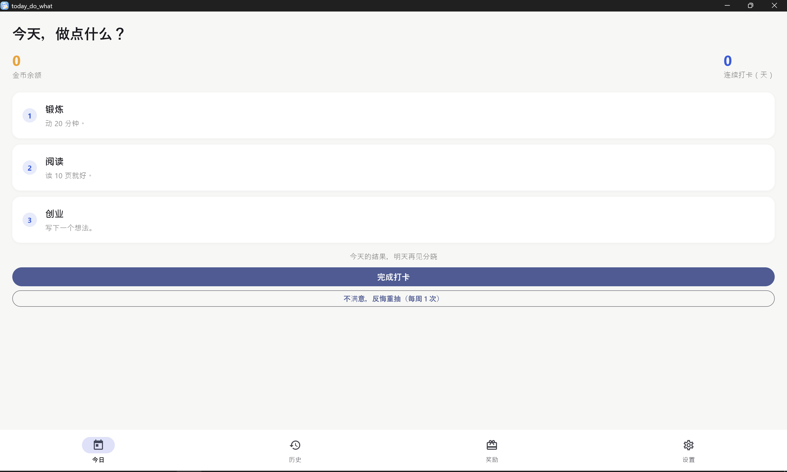

# What_To_Do · 今天干点啥

一个解决「选择困难」的 Flutter 小应用：每天帮你随机抽 3 件该做的事，做完打卡领金币，金币可以兑换自己设定的奖励。支持 Android 和 Windows 双端，并通过 Supabase 云同步。



## 功能

- **每日抽签**：从任务池随机抽 3 件事，翻牌动画揭晓；连续两天被抽中的任务第三天会被排除，保证多样性
- **任务频率**：可设置「每天」「每 N 天一次」，频率任务到期必抽，不受随机与排除规则影响
- **每周一次反悔**：对当天结果不满意？每周有 1 次重抽机会
- **打卡与金币**：完成打卡得金币，连续打卡有 streak 记录
- **奖励兑换**：用金币兑换自定义奖励（一杯奶茶、一局游戏……）
- **365 天历史**：按天回看过去一年抽到并完成了什么
- **自定义任务**：自由增删任务，同名任务自动替换旧任务
- **云同步**：Windows 与 Android 通过同一个同步码互相同步数据，多设备最终一致

## 从源码构建

依赖：[Flutter SDK](https://docs.flutter.dev/get-started/install)、Git。

```bash
git clone https://github.com/George-102/What_To_Do.git
cd What_To_Do/today_do_what
flutter pub get
```

### 配置云同步（可选）

云同步基于 Supabase，需要自行准备一个免费 Supabase 项目：

1. 在 [supabase.com](https://supabase.com) 创建项目，建一张表 `sync_data`：
   - 列 `sync_code`（text，主键）
   - 列 `app_state`（jsonb）
2. 复制 `lib/config/supabase_config.example.dart` 为 `lib/config/supabase_config.dart`，填入你项目的 URL 和 anon key（该文件已被 .gitignore 排除，不会被提交）
3. 不配置时应用仍可正常使用，只是无法跨设备同步

### 运行与打包

```bash
flutter run                    # 连接设备调试运行
flutter build apk --release    # Android
flutter build windows --release  # Windows（产物在 build/windows/x64/runner/Release/）
```

### 运行测试

```bash
flutter test
```

## 仓库结构

- `today_do_what/` — Flutter 应用源码
- `logo.png` — 应用图标源图
